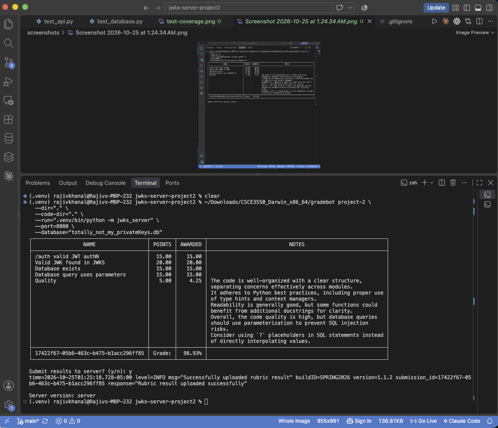
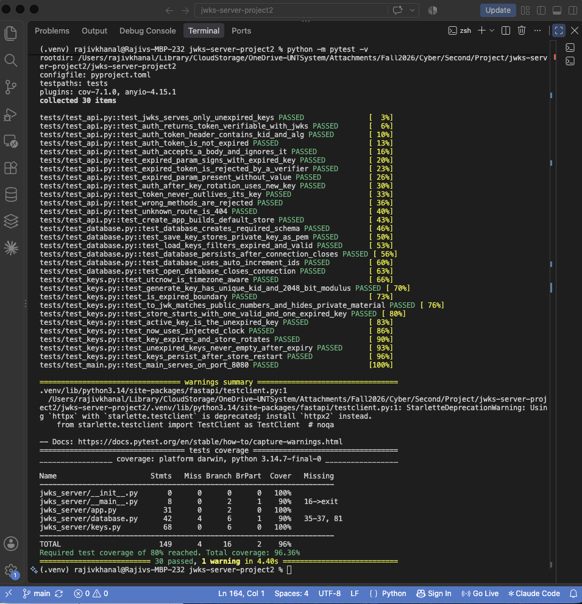

# JWKS Server — CSCE 3550 Project 2

A RESTful JSON Web Key Set (JWKS) server built using **Python, FastAPI, Uvicorn, and SQLite**.

This project extends the original JWKS server by adding persistent storage for RSA private keys in a SQLite database.

## Features

- Generates RSA-2048 public/private key pairs.
- Assigns each key a unique `kid` and expiration timestamp.
- Stores private keys persistently in SQLite.
- Publishes only unexpired public keys through the JWKS endpoint.
- Issues RS256-signed JSON Web Tokens (JWTs).
- Supports expired JWT generation for testing.
- Uses parameterized SQL queries.
- Automatically generates a new valid signing key when needed.
- Includes automated tests and code coverage reporting.

## API Endpoints

| Method | Endpoint | Description |
|---|---|---|
| GET | `/.well-known/jwks.json` | Returns unexpired public keys in JWKS format. |
| POST | `/auth` | Generates a JWT signed using a valid RSA private key. |
| POST | `/auth?expired=true` | Generates an expired JWT signed using an expired RSA private key. |

Authentication is mocked for this assignment. The server does not validate actual usernames or passwords.

## SQLite Database

The application uses a SQLite database named:

`totally_not_my_privateKeys.db`

The database is created automatically when needed.

### Database Schema

```sql
CREATE TABLE IF NOT EXISTS keys (
    kid INTEGER PRIMARY KEY AUTOINCREMENT,
    key BLOB NOT NULL,
    exp INTEGER NOT NULL
);
```

| Column | Description |
|---|---|
| `kid` | Unique key identifier |
| `key` | RSA private key serialized in PEM format |
| `exp` | Key expiration timestamp |

The database stores both valid and expired RSA private keys. Private keys are never exposed through the public JWKS endpoint.

The database file is excluded from Git because it contains sensitive private key material.

## Installation

### 1. Clone the repository

```bash
git clone https://github.com/rajiv48/jwks-server-project2.git
cd jwks-server-project2
```

### 2. Create a virtual environment

```bash
python3 -m venv .venv
source .venv/bin/activate
```

### 3. Install dependencies

```bash
pip install -r requirements.txt
```

### 4. Start the server

```bash
python -m jwks_server
```

The server runs at:

`http://localhost:8080`

## Testing the API

Retrieve public JWKS:

```bash
curl http://localhost:8080/.well-known/jwks.json
```

Generate a valid JWT:

```bash
curl -X POST http://localhost:8080/auth
```

Generate an expired JWT:

```bash
curl -X POST "http://localhost:8080/auth?expired=true"
```

## Automated Tests and Code Coverage

Install development dependencies:

```bash
pip install -r requirements-dev.txt
```

Run the test suite:

```bash
python -m pytest -v
```

Run lint checks:

```bash
python -m ruff check .
```

Check formatting:

```bash
python -m ruff format --check .
```

### Latest Test Results

| Metric | Result |
|---|---|
| Automated tests | 30 passed |
| Code coverage | 96.36% |
| Required coverage | 80% |
| Gradebot Project 2 | 98.93% |

## Gradebot — Project 2

The official CSCE 3550 grading client is available at:

https://github.com/jh125486/CSCE3550/releases

Run the following command from the project directory after downloading Gradebot:

```bash
/path/to/gradebot project-2 \
  --dir="." \
  --code-dir="." \
  --run=".venv/bin/python -m jwks_server" \
  --port=8080 \
  --database="totally_not_my_privateKeys.db"
```

Gradebot automatically starts the application using the provided `--run` command, so the server should not already be running on port 8080.

### Gradebot Results

The Project 2 Gradebot evaluation returned an overall score of **98.93%**.

All major functional checks passed, including valid JWT authentication, JWKS validation, SQLite database detection, and parameterized database queries.

## Screenshots

### Gradebot Evaluation



### Automated Tests and Coverage



## Project Structure

```text
jwks-server-project2/
├── jwks_server/
│   ├── __init__.py
│   ├── __main__.py
│   ├── app.py
│   ├── database.py
│   └── keys.py
├── tests/
│   ├── conftest.py
│   ├── test_api.py
│   ├── test_database.py
│   ├── test_keys.py
│   └── test_main.py
├── screenshots/
│   ├── gradebot-project2.png
│   └── test-coverage.png
├── pyproject.toml
├── requirements.txt
├── requirements-dev.txt
├── .gitignore
└── README.md
```


## Design Notes

**Key persistence:** RSA private keys are stored in SQLite so they can be reused after an application restart.

**Key expiration:** The application maintains expired and valid keys, and generates new valid keys when necessary.

**JWT lifetime:** Normal JWTs expire after 30 minutes or when their signing key expires, whichever occurs first.

**Expired JWTs:** When the `expired` query parameter is present, the server generates a JWT using an expired signing key.

**JWKS security:** Only public components of unexpired RSA keys are published.

**Testability:** The key store supports an injectable clock for deterministic expiration and rotation tests.

## Author

Rajiv Khanal  
University of North Texas  
CSCE 3550 — Project 2
